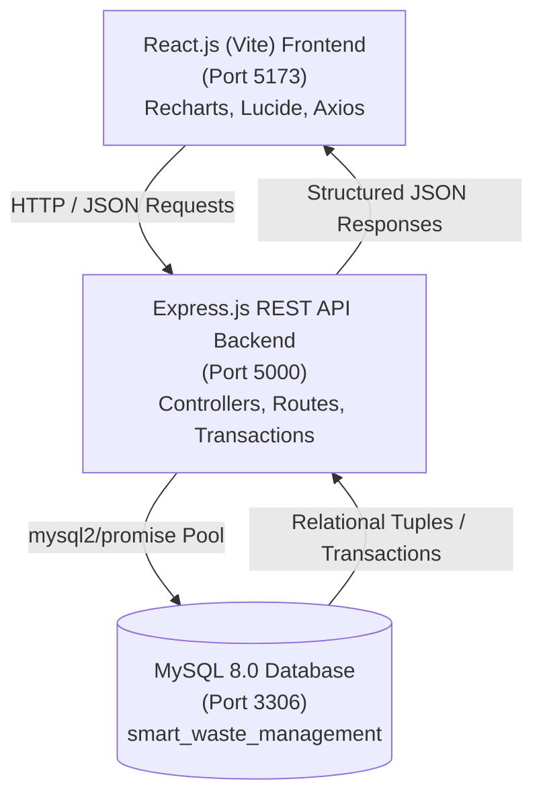

# ♻️ Smart Waste Management System (SWMS)
### B.Tech 2nd Year Computer Science & Engineering — Full Stack DBMS Project

A production-grade, modern, full-stack web application designed for municipal waste monitoring, smart receptacle tracking, automated collection scheduling, crew management, and audit logging.

Built with **React.js + Vite** on the frontend, **Node.js + Express.js** on the backend, and **MySQL 8.0 (InnoDB)** as the relational database.

---

## 📑 Table of Contents
1. [System Architecture](#1-system-architecture)
2. [Technology Stack](#2-technology-stack)
3. [Project Folder Structure](#3-project-folder-structure)
4. [Database Design & Normalization](#4-database-design--normalization)
5. [Table Descriptions & Primary/Foreign Keys](#5-table-descriptions--primaryforeign-keys)
6. [SQL Queries & Aggregate Explanations](#6-sql-queries--aggregate-explanations)
7. [Database Setup Instructions (MySQL Workbench)](#7-database-setup-instructions-mysql-workbench)
8. [Backend Setup & Environment Configuration](#8-backend-setup--environment-configuration)
9. [Frontend Setup & Launch](#9-frontend-setup--launch)
10. [REST API Documentation & Postman Guide](#10-rest-api-documentation--postman-guide)
11. [DBMS Viva Questions & Theoretical Answers](#11-dbms-viva-questions--theoretical-answers)

---

## 1. System Architecture



---

## 2. Technology Stack

- **Frontend**:
  - **Framework**: React.js 19 with Vite bundler
  - **Routing**: `react-router-dom` v7
  - **Visualizations**: `recharts` (BarChart, AreaChart, PieChart, LineChart)
  - **Icons**: `lucide-react`
  - **HTTP Client**: `axios`
  - **Styling**: Vanilla CSS Design System with CSS variables (Dark green sidebar `#103825`, emerald `#16a34a`, clean slate `#f4f6f8` background, rounded cards, subtle shadows)
- **Backend**:
  - **Runtime**: Node.js (v18+)
  - **Framework**: Express.js (v4.21)
  - **Database Driver**: `mysql2/promise` with connection pooling
  - **Logging & Utilities**: `morgan`, `cors`, `dotenv`
- **Database**:
  - **Engine**: MySQL 8.0+ Community Server (InnoDB Engine for ACID transactions)
  - **Tool**: MySQL Workbench 8.0

---

## 3. Project Folder Structure

```
smart-waste-management/
├── backend/
│   ├── config/
│   │   └── db.js                 # MySQL connection pool with mysql2/promise
│   ├── controllers/
│   │   ├── dashboardController.js # Dynamic statistics and chart aggregations
│   │   ├── binsController.js      # CRUD, fill-level alerts, search/filter
│   │   ├── locationsController.js # CRUD, bin counts per ward, integrity checks
│   │   ├── categoriesController.js# CRUD, bin counts, waste segregation
│   │   ├── teamsController.js     # CRUD teams & 1-to-many team members roster
│   │   ├── schedulesController.js # Transactional schedules & schedule_bins bridge
│   │   ├── recordsController.js   # Atomic collection logging & capacity check
│   │   └── reportsController.js   # Advanced SQL aggregate reports
│   ├── middleware/
│   │   └── errorHandler.js        # Maps MySQL error codes to friendly JSON
│   ├── routes/
│   │   ├── dashboardRoutes.js
│   │   ├── binsRoutes.js
│   │   ├── locationsRoutes.js
│   │   ├── categoriesRoutes.js
│   │   ├── teamsRoutes.js
│   │   ├── schedulesRoutes.js
│   │   ├── recordsRoutes.js
│   │   └── reportsRoutes.js
│   ├── scripts/
│   │   └── seed.js                # Auto-seeder script executing database.sql
│   ├── .env                       # Backend database credentials
│   ├── .env.example               # Template environment configuration
│   ├── package.json
│   └── server.js                  # Entry point mounting APIs and error handling
│
├── frontend/
│   ├── src/
│   │   ├── components/
│   │   │   ├── Sidebar.jsx        # Dark green responsive navigation sidebar
│   │   │   ├── Navbar.jsx         # Header with MySQL status & overflow alerts
│   │   │   ├── Layout.jsx         # App shell layout
│   │   │   ├── StatCard.jsx       # Reusable KPI card
│   │   │   ├── FillProgressBar.jsx# 3-tier color-coded capacity bar
│   │   │   ├── StatusBadge.jsx    # Status pills (Active, On Duty, etc.)
│   │   │   ├── Modal.jsx          # Accessible dialog component
│   │   │   ├── ConfirmModal.jsx   # Deletion confirmation dialog
│   │   │   └── Toast.jsx          # Floating alert notifications
│   │   ├── pages/
│   │   │   ├── Dashboard.jsx      # 8 Live KPIs, 4 Recharts, Upcoming runs
│   │   │   ├── Bins.jsx           # Bins CRUD, progress bars, history modal
│   │   │   ├── Locations.jsx      # Locations CRUD with bin density metrics
│   │   │   ├── Categories.jsx     # Waste categories CRUD & weight tracking
│   │   │   ├── Teams.jsx          # Squads CRUD & Team Member Roster
│   │   │   ├── Schedules.jsx      # Many-to-many schedule & bin dispatch
│   │   │   ├── Records.jsx        # Collection history, capacity checks, CSV
│   │   │   └── Reports.jsx        # Category, Location, Team, and Trend analytics
│   │   ├── services/
│   │   │   └── api.js             # Centralized Axios client
│   │   ├── styles/
│   │   │   └── index.css          # Design system stylesheet
│   │   ├── App.jsx                # React Router DOM configuration
│   │   └── main.jsx               # React entry point
│   ├── index.html                 # HTML shell with Google Fonts
│   ├── package.json
│   └── vite.config.js
│
├── database/
│   ├── database.sql               # Full DDL schema with 8 tables & seed records
│   └── grant_permissions.sql      # MySQL Workbench script for user access
├── package.json                   # Root workspace package scripts
└── README.md                      # Comprehensive project documentation
```

---

## 4. Database Design & Normalization

The database adheres to **Third Normal Form (3NF)**:
1. **1NF (First Normal Form)**:
   - All attribute values are atomic (e.g. `pincode`, `contact_number`, `fill_level`).
   - No repeating groups or multivalued arrays; team members are modeled in a dedicated `team_members` table.
2. **2NF (Second Normal Form)**:
   - In 1NF and every non-key attribute is fully functionally dependent on the entire Primary Key.
   - In the composite bridge table `schedule_bins`, non-key attributes (`is_collected`, `collected_at`) depend on the whole composite identity `(schedule_id, bin_id)`.
3. **3NF (Third Normal Form)**:
   - In 2NF with no transitive dependencies ($X \to Y$ where $Y \to Z$).
   - Bin records store foreign keys `location_id` and `category_id`, rather than duplicating location details (`street`, `city`, `pincode`) or category descriptions.

---

## 5. Table Descriptions & Primary/Foreign Keys

### 1. `locations`
Stores geographical collection areas, wards, and street definitions.
- **Primary Key**: `location_id` (INT AUTO_INCREMENT)
- **Attributes**: `area_name` (VARCHAR 100), `street` (VARCHAR 150), `city` (VARCHAR 100), `pincode` (VARCHAR 10), `description` (TEXT), `created_at` (TIMESTAMP).
- **Referential Integrity**: Referenced by `bins(location_id)` and `schedules(location_id)`. `ON DELETE RESTRICT` prevents deletion of locations containing installed bins or scheduled runs.

### 2. `waste_categories`
Stores standardized classification of segregated waste streams.
- **Primary Key**: `category_id` (INT AUTO_INCREMENT)
- **Attributes**: `category_name` (VARCHAR 50 UNIQUE), `description` (TEXT), `created_at` (TIMESTAMP).
- **Default Records**: Organic Waste, Plastic Waste, Paper Waste, Metal Waste, Glass Waste, General Waste.
- **Referential Integrity**: Referenced by `bins(category_id)` with `ON DELETE RESTRICT`.

### 3. `bins`
Stores smart waste receptacles with capacities, fill levels, and status.
- **Primary Key**: `bin_id` (INT AUTO_INCREMENT)
- **Unique Key**: `bin_code` (VARCHAR 50 UNIQUE) — Prevents duplicate bin codes across the municipality.
- **Foreign Keys**:
  - `location_id` $\to$ `locations(location_id)`
  - `category_id` $\to$ `waste_categories(category_id)`
- **Constraints**:
  - `chk_fill_level`: `CHECK (fill_level >= 0.00 AND fill_level <= 100.00)`
  - `chk_capacity`: `CHECK (capacity_kg > 0)`
- **Status ENUM**: `'Active'`, `'Inactive'`, `'Maintenance'`

### 4. `teams`
Stores waste collection squads and field supervisors.
- **Primary Key**: `team_id` (INT AUTO_INCREMENT)
- **Unique Key**: `team_name` (VARCHAR 100 UNIQUE)
- **Attributes**: `team_leader` (VARCHAR 100), `contact_number` (VARCHAR 20), `status` ENUM(`'Active'`, `'Inactive'`, `'On Duty'`).

### 5. `team_members`
Stores individual crew members belonging to collection teams (1-to-Many).
- **Primary Key**: `member_id` (INT AUTO_INCREMENT)
- **Foreign Key**: `team_id` $\to$ `teams(team_id)` with `ON DELETE CASCADE` (deleting a team cleans up its member roster).
- **Attributes**: `member_name` (VARCHAR 100), `phone_number` (VARCHAR 20), `role` (VARCHAR 50).

### 6. `schedules`
Stores planned collection runs for locations and assigned squads.
- **Primary Key**: `schedule_id` (INT AUTO_INCREMENT)
- **Foreign Keys**:
  - `location_id` $\to$ `locations(location_id)` (`ON DELETE RESTRICT`)
  - `team_id` $\to$ `teams(team_id)` (`ON DELETE RESTRICT`)
- **Status ENUM**: `'Pending'`, `'In Progress'`, `'Completed'`, `'Cancelled'`
- **Attributes**: `collection_date` (DATE), `start_time` (TIME).

### 7. `schedule_bins` (Many-to-Many Bridge Table)
Maps multiple bins to a scheduled collection run.
- **Primary Key**: `schedule_bin_id` (INT AUTO_INCREMENT)
- **Unique Composite Key**: `unique_schedule_bin (schedule_id, bin_id)` — Prevents duplicate assignment of the same bin to the same schedule.
- **Foreign Keys**:
  - `schedule_id` $\to$ `schedules(schedule_id)` (`ON DELETE CASCADE`)
  - `bin_id` $\to$ `bins(bin_id)` (`ON DELETE RESTRICT`)
- **Attributes**: `is_collected` (BOOLEAN DEFAULT FALSE), `collected_at` (DATETIME NULL).

### 8. `collection_records`
Permanent audit log of verified waste collections, weight measurements, and timestamps.
- **Primary Key**: `record_id` (INT AUTO_INCREMENT)
- **Foreign Keys**:
  - `schedule_id` $\to$ `schedules(schedule_id)` (`ON DELETE SET NULL`)
  - `bin_id` $\to$ `bins(bin_id)` (`ON DELETE RESTRICT`)
  - `team_id` $\to$ `teams(team_id)` (`ON DELETE RESTRICT`)
- **Constraint**: `chk_collected_quantity`: `CHECK (collected_quantity_kg > 0)`
- **Attributes**: `collected_quantity_kg` (DECIMAL 8,2), `collection_datetime` (DATETIME), `remarks` (TEXT).

---

## 6. SQL Queries & Aggregate Explanations

### A. Dynamic Dashboard KPI Retrieval
```sql
SELECT 
  (SELECT COUNT(*) FROM bins) AS total_bins,
  (SELECT COUNT(*) FROM bins WHERE status = 'Active') AS active_bins,
  (SELECT COUNT(*) FROM locations) AS total_locations,
  (SELECT COUNT(*) FROM teams WHERE status IN ('Active', 'On Duty')) AS active_teams,
  (SELECT COUNT(*) FROM schedules WHERE collection_date = CURDATE()) AS today_schedules,
  (SELECT COUNT(*) FROM schedules WHERE status IN ('Pending', 'In Progress')) AS pending_collections,
  (SELECT COUNT(*) FROM schedules WHERE status = 'Completed') AS completed_collections,
  (SELECT COALESCE(SUM(collected_quantity_kg), 0) FROM collection_records) AS total_waste_collected_kg;
```
*Purpose*: Retrieves all top-level KPIs in a single efficient query execution using scalar subqueries.

### B. Waste Collected by Category (JOIN, SUM, GROUP BY)
```sql
SELECT 
  wc.category_id,
  wc.category_name,
  COALESCE(SUM(cr.collected_quantity_kg), 0) AS total_kg,
  COUNT(cr.record_id) AS collection_count
FROM waste_categories wc
LEFT JOIN bins b ON b.category_id = wc.category_id
LEFT JOIN collection_records cr ON cr.bin_id = b.bin_id
GROUP BY wc.category_id, wc.category_name
ORDER BY total_kg DESC;
```
*Explanation*: Uses `LEFT JOIN` so that categories with zero collections still appear with 0 kg rather than being omitted.

### C. Monthly Waste Collection Trend (Date Functions & GROUP BY)
```sql
SELECT 
  DATE_FORMAT(collection_datetime, '%Y-%m') AS month_key,
  DATE_FORMAT(collection_datetime, '%b %Y') AS month_label,
  ROUND(COALESCE(SUM(collected_quantity_kg), 0), 2) AS total_kg,
  COUNT(record_id) AS total_pickups
FROM collection_records
WHERE collection_datetime >= DATE_SUB(CURDATE(), INTERVAL 6 MONTH)
GROUP BY month_key, month_label
ORDER BY month_key ASC;
```

### D. Transactional Atomic Collection Recording
When a collection is recorded, a MySQL transaction executes:
```sql
START TRANSACTION;

-- 1. Insert record
INSERT INTO collection_records 
(schedule_id, bin_id, team_id, collected_quantity_kg, collection_datetime, remarks)
VALUES (1, 5, 2, 85.50, NOW(), 'Morning clearance');

-- 2. Reset bin fill level to 0%
UPDATE bins SET fill_level = 0.00 WHERE bin_id = 5;

-- 3. Mark bin collected in schedule
UPDATE schedule_bins SET is_collected = TRUE, collected_at = NOW() 
WHERE schedule_id = 1 AND bin_id = 5;

-- 4. Check if all bins in this schedule are collected
-- If remaining count is 0, update schedule to 'Completed'
UPDATE schedules SET status = 'Completed' 
WHERE schedule_id = 1 AND (
    SELECT COUNT(*) FROM schedule_bins WHERE schedule_id = 1 AND is_collected = FALSE
) = 0;

COMMIT;
```

---

## 7. Database Setup Instructions (MySQL Workbench)

### Step 1: Open MySQL Workbench
Launch **MySQL Workbench** and connect to your local MySQL instance (e.g., `Local instance MySQL80` as `root`).

### Step 2: Grant Permissions (If using job_portal_user)
Open `database/grant_permissions.sql` in MySQL Workbench and execute:
```sql
CREATE DATABASE IF NOT EXISTS smart_waste_management
  CHARACTER SET utf8mb4
  COLLATE utf8mb4_unicode_ci;

GRANT ALL PRIVILEGES ON smart_waste_management.* TO 'job_portal_user'@'localhost';
GRANT ALL PRIVILEGES ON smart_waste_management.* TO 'job_portal_user'@'127.0.0.1';
FLUSH PRIVILEGES;
```

### Step 3: Run Database Schema and Seed Data
In MySQL Workbench, open file `database/database.sql` and click the **Lightning Bolt (Execute)** icon.
This will:
- Create all 8 normalized InnoDB tables.
- Establish all primary and foreign key constraints.
- Seed default waste categories, 6 zones, 16 bins, 4 teams, 10 personnel, 8 schedules, and 15 collection logs.

---

## 8. Backend Setup & Environment Configuration

### Step 1: Navigate to Backend
```powershell
cd "c:\Users\ashmi\Downloads\DBMS\dbms hackathon\backend"
```

### Step 2: Configure Environment Variables
Open `backend/.env` and verify credentials:
```ini
PORT=5000
NODE_ENV=development

DB_HOST=localhost
DB_PORT=3306
DB_USER=job_portal_user
DB_PASSWORD=JobPortal123
DB_NAME=smart_waste_management

FRONTEND_URL=http://localhost:5173
```
*(If connecting as `root`, update `DB_USER=root` and your `DB_PASSWORD`).*

### Step 3: Start the Backend Server
```powershell
# Development mode with auto-reload:
npm run dev

# Or standard production start:
npm start
```
The server will start at **http://localhost:5000** and output:
```
[MySQL] Successfully connected to database 'smart_waste_management' on localhost:3306 as 'job_portal_user'.
🚀 [Smart Waste Management API] Server running on http://localhost:5000
📡 Health Check: http://localhost:5000/api/health
```

---

## 9. Frontend Setup & Launch

### Step 1: Navigate to Frontend
```powershell
cd "c:\Users\ashmi\Downloads\DBMS\dbms hackathon\frontend"
```

### Step 2: Launch Vite Dev Server
```powershell
npm run dev
```
Open **http://localhost:5173** in your browser.

---

## 10. REST API Documentation & Postman Guide

Base URL: `http://localhost:5000/api`

| Module | Method | Endpoint | Description |
| :--- | :--- | :--- | :--- |
| **System** | `GET` | `/health` | API & database status check |
| **Dashboard** | `GET` | `/dashboard/stats` | Dynamic KPIs, 4 charts, urgent bins |
| **Bins** | `GET` | `/bins` | List bins (supports `?search=`, `?location_id=`, `?category_id=`, `?status=`) |
| **Bins** | `GET` | `/bins/:id` | Get single bin with collection history |
| **Bins** | `POST` | `/bins` | Create new bin (`bin_code`, `location_id`, `category_id`, `capacity_kg`, `fill_level`, `status`) |
| **Bins** | `PUT` | `/bins/:id` | Update bin details |
| **Bins** | `DELETE`| `/bins/:id` | Delete bin (blocked if referenced in logs/schedules) |
| **Locations**| `GET` | `/locations` | List locations with bin counts (`COUNT(b.bin_id)`) |
| **Locations**| `POST` | `/locations` | Add location (`area_name`, `street`, `city`, `pincode`, `description`) |
| **Locations**| `PUT` | `/locations/:id` | Update location |
| **Locations**| `DELETE`| `/locations/:id` | Delete location (blocked if in use) |
| **Categories**| `GET`| `/categories` | List categories with bin counts and total waste |
| **Categories**| `POST`| `/categories` | Add category (`category_name`, `description`) |
| **Categories**| `PUT` | `/categories/:id`| Update category |
| **Categories**| `DELETE`| `/categories/:id`| Delete category (blocked if bins assigned) |
| **Teams** | `GET` | `/teams` | List teams with crew size and total collected kg |
| **Teams** | `POST` | `/teams` | Create team (`team_name`, `team_leader`, `contact_number`, `status`) |
| **Teams** | `PUT` | `/teams/:id` | Update team details |
| **Teams** | `DELETE`| `/teams/:id` | Delete team |
| **Members** | `GET` | `/teams/:teamId/members` | Get members of a specific team |
| **Members** | `POST` | `/teams/:teamId/members` | Add member (`member_name`, `phone_number`, `role`) |
| **Members** | `DELETE`| `/teams/members/:memberId` | Remove member |
| **Schedules**| `GET`| `/schedules` | List schedules (`?date=`, `?location_id=`, `?team_id=`, `?status=`) |
| **Schedules**| `POST`| `/schedules` | Create schedule with array of `bin_ids` (Transaction) |
| **Schedules**| `GET` | `/schedules/:id`| View schedule details with assigned bins |
| **Schedules**| `PUT` | `/schedules/:id`| Update schedule |
| **Schedules**| `DELETE`| `/schedules/:id`| Delete schedule (cascades to `schedule_bins`) |
| **Records** | `GET` | `/records` | List collection records with summary KPI |
| **Records** | `POST` | `/records` | Record collection event (Transaction: resets bin fill, updates schedule) |
| **Records** | `DELETE`| `/records/:id`| Delete record |
| **Records** | `GET` | `/records/bin/:binId` | Audit history for specific bin |
| **Reports** | `GET` | `/reports/analytics` | SQL aggregations (Category, Location, Team, Daily, Monthly) |

---

## 11. DBMS Viva Questions & Theoretical Answers

### Q1: What database engine did you use and why?
**Answer**: We used **MySQL InnoDB**. InnoDB is an ACID-compliant storage engine that supports **foreign key constraints**, row-level locking, and **atomic multi-statement transactions (`START TRANSACTION`, `COMMIT`, `ROLLBACK`)**, which are critical for preventing race conditions during waste collection logging.

### Q2: How did you implement the Many-to-Many relationship between Schedules and Bins?
**Answer**: A collection schedule involves multiple bins, and a bin can be collected across many schedules over time. We decomposed this Many-to-Many relationship into two One-to-Many relationships using the bridge table **`schedule_bins`**, containing composite foreign keys `schedule_id` and `bin_id`. We applied a `UNIQUE KEY (schedule_id, bin_id)` constraint to prevent duplicate bin assignments.

### Q3: How do you enforce data integrity when recording a waste collection?
**Answer**:
1. **Validation constraint**: In `recordsController.js`, we ensure `collected_quantity_kg <= bin.capacity_kg`.
2. **Database Check constraint**: `CONSTRAINT chk_collected_quantity CHECK (collected_quantity_kg > 0)`.
3. **ACID Transaction**: Both the insertion of the collection record, updating the bin's fill level to 0%, and updating the schedule status to 'Completed' occur within a single database transaction. If any step fails, the entire transaction is rolled back.

### Q4: Why are `ON DELETE RESTRICT` and `ON DELETE CASCADE` used in different places?
**Answer**:
- **`ON DELETE CASCADE`** is used for dependent child tables that have no independent meaning without the parent (e.g. deleting a `schedule` cascades to delete its `schedule_bins` rows; deleting a `team` cascades to delete its `team_members`).
- **`ON DELETE RESTRICT`** is used for critical business entities (e.g. a `location` or `waste_category` cannot be deleted if bins or schedules reference it), preventing accidental orphan records and maintaining referential integrity.
- **`ON DELETE SET NULL`** is used on `collection_records(schedule_id)` so that historical waste collection audit logs are preserved even if an old schedule is purged.

---

### Project Developed for B.Tech Computer Science & Engineering DBMS Laboratory Examination.
All Rights Reserved © 2026.
